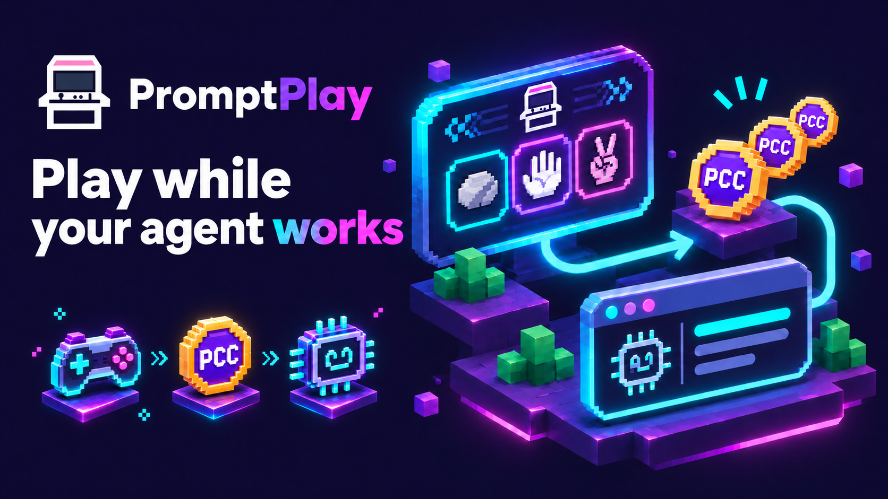
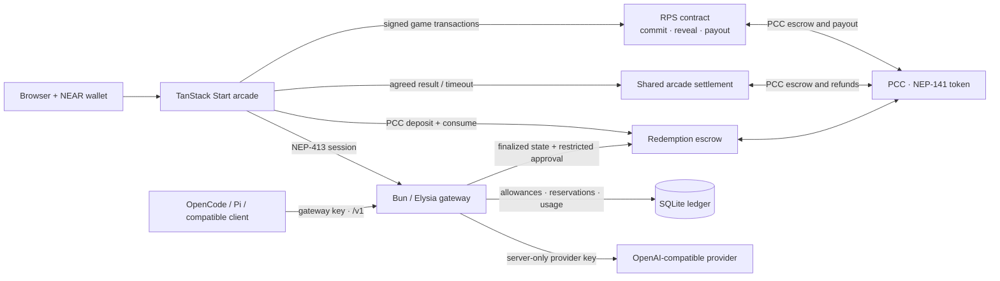

# PromptPlay

<p align="center">
  
</p>
<p align="center">
  
  
  
  
  
</p>

**PromptPlay** turns downtime while a coding agent works into an arcade where Testnet game credits can be redeemed for metered AI inference.

- **Deployed Project:** [promptplay-web.ryanlau1220.workers.dev](https://promptplay-web.ryanlau1220.workers.dev)
- **Live Demo:** [Watch the demo video on YouTube](https://youtu.be/jZ4YRjUisMg)

<p align="center">
  
</p>

**Challenge:** [Track 13 - Open Innovation](https://nearhackathon.com/)

> This is a Testnet prototype, not a real-money product. PCC and NEAR are Testnet assets. The 11 solo practice games do not award PCC. Live inference depends on the operator's provider, funding, gateway capacity and configuration.

## Table of Contents

- [Project Overview](#project-overview)
- [Installation & Setup](#installation--setup)
- [Project Structure](#project-structure)
- [System Architecture](#system-architecture)
- [Tech Stack](#tech-stack)
- [Core Features](#core-features)
- [Essential Commands](#essential-commands)
- [Data, Findings & Limitations](#data-findings--limitations)

## Project Overview

PromptPlay connects a NEAR Testnet arcade to a provider-configurable inference gateway. Two players can stake PromptPlay Compute Credits (PCC) in an on-chain Rock Paper Scissors duel, while 11 other games offer wallet-free solo practice. Eligible PCC can be exchanged for an allowance used by OpenCode, Pi and other compatible clients.

1. **Explore the arcade:** play a practice game or try the wallet-free simulation. Neither awards real PCC or calls an AI provider.
2. **Play a Testnet duel:** connect two NEAR Testnet wallets, deposit the stakes, commit and reveal moves, and claim the contract's payout.
3. **Redeem PCC:** deposit eligible credits into the refundable redemption escrow and authorize consumption to receive an inference allowance.
4. **Use the gateway:** create a gateway key and call a configured model from the Inference Hub or a compatible coding agent.

To try the simulated flow, open the [deployed arcade](https://promptplay-web.ryanlau1220.workers.dev), select **Play the wallet-free demo**, choose **Paper** then **Rock**, and follow the simulated payout, redemption and mock inference steps. For a real duel, use two separately connected Testnet wallet profiles with NEAR for gas, PCC storage registration and sufficient PCC. Keep the same browser profiles through reveal: move secrets are stored locally. The deployed faucet, when available, provides a capped Testnet allocation.

The [demo video](https://youtu.be/jZ4YRjUisMg) follows one winning wallet from match 12 through payout, redemption, credited allowance, a live browser model response and an OpenCode file read. The 2 PCC payout includes the winner's original 1 PCC stake; the 5 PCC redeemed came from the wallet's accumulated balance. Transaction waits are edited, the key is concealed and OpenCode events are presented as a formatted trace.

## Installation & Setup

### Prerequisites

- [Bun 1.3.10](https://bun.sh/), as pinned in `package.json`, and network access to a NEAR Testnet RPC.
- A browser; a NEAR Testnet wallet is optional for practice and the simulated demo.
- [Rust](https://rustup.rs/) 1.97.1 with `rustfmt` for `bun run check`; contract builds and tests also need the `wasm32-unknown-unknown` target and `cargo-near` 0.22.0.

### Run the application

```sh
git clone https://github.com/ryanlau1220/PromptPlay.git
cd PromptPlay
bun install --frozen-lockfile
bun run dev
```

Open [http://localhost:3000](http://localhost:3000); the API runs at `http://localhost:3001`. The server uses a local SQLite database and checks that its RPC is on Testnet. Live inference, redemption and the PCC faucet are **off by default** without operator configuration. Practice, the wallet-free simulation and `bun run demo:mock` do not require provider or wallet credentials; the mock does not transfer tokens or call an AI provider. See [`apps/server/.env.example`](apps/server/.env.example) and [`apps/web/.env.example`](apps/web/.env.example) for configuration. Never commit credentials, SQLite ledgers or wallet keys.

### Build smart contracts

Install Rust with [rustup](https://rustup.rs/), run `rustup target add wasm32-unknown-unknown`, and install the pinned `cargo-near` version using the installer in [CI](.github/workflows/ci.yml). Run `bun run build:contracts` from the repository root. Contract sandbox tests also require the NEAR sandbox binary.

### Deployment

The deployed frontend runs on Cloudflare Workers. A Cloudflare Tunnel connects it to a Bun server with a persistent SQLite ledger on a VPS. Live operation requires private provider credentials, pricing and model limits, the redemption escrow and restricted approval key, and activation flags described in [`apps/server/.env.example`](apps/server/.env.example). Use one persistent authoritative database and back it up: resetting it does not reconcile on-chain deposits or outstanding balances. [GitHub Actions](.github/workflows/) runs the project's checks and tests.

## Project Structure

```text
PromptPlay/
├── apps/
│   ├── web/                 # Arcade, wallet UI, simulation and inference hub
│   └── server/              # Wallet sessions, redemption, inference and metering
├── contracts/
│   ├── compute-credit/      # PCC NEP-141 fungible token
│   ├── rps-game/            # Commit–reveal RPS and payouts
│   ├── arcade-settlement/   # Mutual-agreement settlement and timeout refunds
│   └── redemption-escrow/   # Refundable PCC-to-allowance deposits
├── deployments/             # Testnet addresses and verification evidence
├── scripts/                 # Browser, Testnet and contract verification tools
├── .github/workflows/       # CI workflows
├── PromptPlay-DemoVideo.mp4 # Recorded demonstration
```

## System Architecture



The browser signs transactions on NEAR Testnet. The gateway verifies finalized escrow state, maintains the allowance ledger and forwards eligible inference requests using a server-only provider key. Nebius Token Factory was used for the deployed demo; not every compatible provider or feature has been verified.

## Tech Stack

| Area | Technology | Purpose |
| --- | --- | --- |
| Interface | React, TypeScript, TanStack Start, Vite | Arcade, wallet flows and inference hub |
| Wallet and chain | NEAR Connect, near-api-js, NEAR Testnet | Wallet sessions and blockchain interactions |
| Smart contracts | Rust, near-sdk, NEP-141 | PCC, game settlement and redemption escrow |
| Gateway and storage | Bun, Elysia, SQLite | Sessions, redemption, inference metering and ledger |
| Hosting and delivery | Cloudflare Workers, Cloudflare Tunnel, VPS | Frontend hosting and gateway connectivity |
| Quality and automation | Bun test, Biome, TypeScript, Rust tests, Playwright, GitHub Actions | Checks, contract and browser tests, and CI |

## Core Features

- **Arcade and simulation:** 11 wallet-free practice games and a simulated game-to-compute journey without token rewards or live inference.
- **On-chain RPS duels:** two players stake PCC, commit and reveal moves, play first-to-two rounds and claim the payout; ties and timeouts follow contract rules.
- **Shared settlement:** a separate contract settles player-agreed results and provides timeout refunds. It does not verify the rules of the practice games.
- **Refundable redemption:** PCC deposits are checked against finalized escrow state and consumed before the gateway credits an allowance; rejected transfers and expired deposits have refund paths.
- **Inference gateway:** OpenAI-compatible Chat Completions and a stateless subset of Responses, with provider configuration, metering and support for compatible clients. Unsupported Responses features are rejected.
- **Wallet and usage controls:** NEP-413 wallet sessions, hashed gateway keys, replay protection, request reservations, and account and project usage controls.
- **Match history and notifications:** recorded match events and browser push notifications for resolved matches when configured.

## Essential Commands

Run from the repository root unless stated otherwise.

| Command | Purpose |
| --- | --- |
| `bun install --frozen-lockfile` | Install the pinned JavaScript dependencies |
| `bun run dev` | Start the web app and API locally |
| `bun run demo:mock` | Run the offline simulated redemption and inference demonstration |
| `bun run check` | Run Biome lint, Rust formatting and TypeScript checks |
| `bun run test:apps` | Run web and server tests |
| `bun run test:contracts` | Build contracts and run Rust and sandbox tests |
| `bun run test` | Run app and contract suites |
| `bun run build:web` | Build the frontend |
| `bun run build` | Build contracts and the frontend |
| `bun run verify:testnet` | Check recorded deployment and transaction evidence against an archival Testnet RPC |
| `bun run test:browser` | Run the configured two-wallet Testnet browser journey |
| `bun run test:timeouts` | Exercise the real five-minute contract deadlines |

The browser test submits Testnet transactions and requires two pre-funded Meteor 0.8.11 profiles, Python Playwright 1.64.1 and Chromium. Set `METEOR_TEST_PROFILE_DIR` (containing `profile-0` and `profile-1`), `METEOR_PASSWORD_FILE`, `METEOR_EXTENSION_PATH`, `TESTNET_PLAYER_A` and `TESTNET_PLAYER_B`; use `BROWSER_TEST_HEADED=true` for a visible browser. With a funded, enabled gateway and OpenCode, `BROWSER_TEST_REDEEM=true` also exercises redemption, browser inference and an OpenCode file read. See [the runner](scripts/test-browser-match.py) for recovery options. Keep the extension at the path used to create the profiles; if interrupted, preserve the profiles and inspect the chain before retrying.

## Data, Findings & Limitations

| Evidence / area | What it demonstrates | Important boundary |
| --- | --- | --- |
| [Match 12 payout](https://testnet.nearblocks.io/txns/2Dt3N1aaxc8UUwgYF83NaZQXUAWtVYGPKH11yDPdd116) | `arcade-a.ryanlau1220.testnet` won and claimed a 2 PCC pot | The payout includes the winner's original 1 PCC stake. |
| [Match 12 redemption](https://testnet.nearblocks.io/txns/5e2p2dzLFktTJ1Xe4Fpitx1TAWeDfS3VNb95Axmt6ycK) | The same wallet deposited 5 PCC into redemption escrow; the recorded deposit was approved and consumed | The 5 PCC came from the accumulated wallet balance, not solely the match payout. |
| Live inference and OpenCode | The recorded journey shows a model response and an OpenCode file read using the same wallet's gateway allowance | These are off-chain evidence; chain checks cannot independently verify the model response or trace individual token units. |
| Testnet verification | `bun run verify:testnet` checks recorded match, payout, deposit and consumed escrow state, including matches 11 and 12 | It does not perform a new match or inference request. See [deployment records](deployments/testnet.json). |
| Games and settlement | RPS has on-chain commit–reveal rules; shared settlement supports mutual agreement and timeout refunds | Practice games award no PCC; shared settlement does not independently verify their rules. |
| Provider and gateway | Provider endpoint, model and credentials are configurable; gateway reservations and limits protect the ledger | Pricing, funding, provider availability and capabilities are external dependencies. OpenCode and Pi have been exercised, not every compatible client or provider. |
| Contract control and review | Escrow approvals use a restricted function-call key | The PCC issuer can mint. Contract accounts had full-access keys at review, enabling their holders to replace code. Contracts have not received an independent security audit. |
| Dependencies | Contract lockfile scans reported [RUSTSEC-2026-0387](https://rustsec.org/advisories/RUSTSEC-2026-0387.html) and [RUSTSEC-2024-0449](https://rustsec.org/advisories/RUSTSEC-2024-0449.html) | Neither appeared in the normal Wasm dependency trees at review; these remain host-side dependency findings. |

Gateway keys are shown once and stored as hashes. Requests reserve allowance before contacting the provider, and uncertain requests retain reservations. Streaming and tool calls depend on the configured provider. This prototype is not a self-funding economy; real provider costs remain the operator's responsibility.


Built during [NEAR Hackathon 2026](https://nearhackathon.com/)