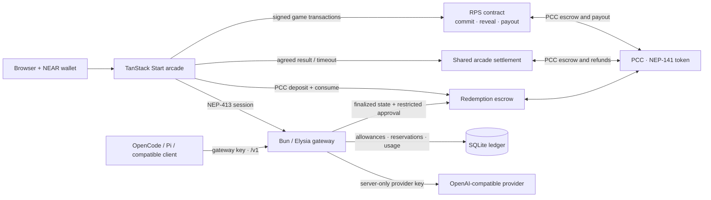

# PromptPlay

**Play while your coding agent works. Turn Testnet game credits into metered AI inference.**

[Open the arcade](https://promptplay-web.ryanlau1220.workers.dev) · [Watch the demo](PromptPlay-DemoVideo.mp4) · [Submission details](SUBMISSION.md) · [Testnet deployments](deployments/testnet.json)

PromptPlay is a NEAR Testnet arcade with a practical destination for its in-game currency: a configurable inference gateway for coding agents. In the on-chain Rock Paper Scissors duel, two players stake PromptPlay Compute Credits (PCC), commit and reveal their moves, and claim the contract's payout. Eligible PCC can be redeemed for an allowance used by OpenCode, Pi and other compatible clients.

**Scope:** PCC and NEAR used here are Testnet assets. The 11 additional games are wallet-free solo practice and do not award PCC. The separate shared-settlement contract supports player-agreed outcomes and timeout refunds; it does not verify those games' rules. This is a prototype, not a real-money product.

## Try it

1. Open the [deployed arcade](https://promptplay-web.ryanlau1220.workers.dev) and select **Play the wallet-free demo**. Choose **Paper**, then **Rock** → see two round wins; choose **Claim simulated payout**, **Redeem 5 simulated PCC**, then **Run a mock inference request** → see `0.999994 units`. These operations are simulated: no wallet, blockchain transactions or provider are involved. The 11 practice games are also wallet-free.
2. For a real duel, choose **Duel Arena** and connect two different NEAR Testnet wallets in separate browser profiles. Each needs Testnet NEAR for gas and storage, PCC storage registration, and enough PCC for the agreed stake. The deployed faucet, when available, provides a capped Testnet allocation.
3. Create a room with the other player's account, share its link, and have both players deposit, commit, and reveal. Keep the same browser profiles: reveal secrets are stored locally. The first player to win two rounds can claim the pot; ties and timeouts follow the contract rules.
4. In **Inference Hub**, sign the wallet challenge, create a redemption intent, deposit **5 PCC**, and authorize consumption to receive **1 gateway unit**. Create a gateway key and use the displayed OpenCode or Pi configuration. The upstream provider key stays on the server. Live redemption depends on gateway capacity, provider availability and wallet eligibility.

The demo video follows the same winning wallet through [match 12 payout](https://testnet.nearblocks.io/txns/2Dt3N1aaxc8UUwgYF83NaZQXUAWtVYGPKH11yDPdd116), [5 PCC redemption](https://testnet.nearblocks.io/txns/5e2p2dzLFktTJ1Xe4Fpitx1TAWeDfS3VNb95Axmt6ycK), credited allowance, live browser inference and an OpenCode file read. The 2 PCC payout includes the winner’s original 1 PCC stake; the 5 PCC redeemed came from the wallet’s accumulated balance. Transaction waits are edited, the key is concealed and the OpenCode events are shown as a formatted trace.

For a read-only check, inspect [match 10's payout](https://testnet.nearblocks.io/txns/GVGyAX3Cyqy1eSYkmvQCrt7JjNNwUuyJYvyWk61KXh7M) → its successful PCC transfer receipt pays 2 PCC from `game2.ryanlau1220.testnet` to `arcade-a.ryanlau1220.testnet`. Separately, inspect [a redemption deposit](https://testnet.nearblocks.io/txns/B6BD8jpL1W199bfFdJ6qUyTjKyTEYDCCZZ2pBWzM186Q) → its PCC transfer receipt sends 5 PCC from that account to the redemption escrow. These links are independent evidence; they do not prove that this payout funded that deposit.

A later browser test used one winning wallet throughout: [match 11 payout](https://testnet.nearblocks.io/txns/H8tfJDLCQdYxjeqdkqt9nXdCnir7Ce7AYwATHS8Y1MNA) → [5 PCC redemption deposit](https://testnet.nearblocks.io/txns/9AB2LdfgLbppe5k4wLMRFMDNq4vyeGpYEetMYdYtx3GR) → approved, consumed escrow → browser inference and an OpenCode file read. The runner recorded allowance falling from `9.668900` to `9.667329` units during the agent run and rejected a replay. Run `bun run verify:testnet` → see `browserJourney` and `browserVideoJourney` with the finalized matches, payouts, deposits and consumed states. Those chain checks do not independently verify the server-side inference or trace individual token units.

## Architecture



The deployed frontend runs on Cloudflare Workers. A Cloudflare tunnel connects it to a single Bun server and persistent SQLite ledger on a VPS. The browser talks to NEAR Testnet for wallet-signed transactions; the server verifies finalized escrow state and meters gateway requests. The provider is configurable; Nebius Token Factory was used for the deployed demo, not every compatible provider or feature has been verified.

## Run locally

Requirements: [Bun 1.3.10](https://bun.sh/) and internet access to a NEAR Testnet RPC. A wallet is optional for practice and the simulated demo. Rust 1.97.1 with `rustfmt` is needed for `bun run check`; building or testing the contracts also needs the `wasm32-unknown-unknown` target and `cargo-near` 0.22.0.

For the contract toolchain, install Rust with [rustup](https://rustup.rs/), run `rustup target add wasm32-unknown-unknown`, and install `cargo-near` using the pinned installer in [CI](.github/workflows/ci.yml).

```sh
bun install --frozen-lockfile
bun run dev
```

Open [http://localhost:3000](http://localhost:3000). The API runs at `http://localhost:3001`. The server uses a local SQLite database and checks its RPC is on Testnet. Live inference, redemption and the PCC faucet are **off by default** without operator configuration; practice, the wallet-free simulation, and the mock below do not need provider or wallet credentials. `apps/server/.env.example` and `apps/web/.env.example` list the settings. Never commit credentials, SQLite ledgers or wallet keys.

For a deterministic, offline gateway/accounting demonstration:

```sh
bun run demo:mock
```

This simulates the escrow and provider response in memory; it does not make a blockchain transfer or call an AI provider.

## Verify

From the repository root:

```sh
bun run check           # Biome lint, Rust formatting and TypeScript checks
bun run test:apps       # web and server tests
bun run build:web       # production frontend build
bun run test:contracts  # build contracts and run Rust and sandbox tests
bun run test            # app and contract suites
bun run build           # contracts and frontend
```

Contract builds and sandbox tests require the Rust/Wasm tools above; sandbox tests also need the NEAR sandbox binary. `bun run test:timeouts` separately exercises real five-minute contract deadlines. `bun run verify:testnet` checks recorded deployment and transaction evidence against an archival Testnet RPC; it does not run a new match or inference request.

`bun run test:browser` makes Testnet transactions using two pre-funded Meteor 0.8.11 profiles and Python Playwright 1.64.1 with Chromium. Set `METEOR_TEST_PROFILE_DIR` (containing `profile-0` and `profile-1`), `METEOR_PASSWORD_FILE`, `METEOR_EXTENSION_PATH`, `TESTNET_PLAYER_A`, and `TESTNET_PLAYER_B`; set `BROWSER_TEST_HEADED=true` when a visible browser is needed. With a funded, enabled gateway and OpenCode, `BROWSER_TEST_REDEEM=true` also exercises redemption, browser inference and an OpenCode file read. See [the runner](scripts/test-browser-match.py) for recovery options. Keep the extension at the path used to create the profiles. If interrupted, preserve the profiles and inspect the chain before retrying.

CI runs checks, app tests and the web build separately from contract builds and tests. The project is available under the [MIT License](LICENSE).

The project uses TanStack Start, React, Bun, Elysia, near-api-js, near-sdk and NEAR's fungible-token standards. The PCC implementation is adapted from the MIT/Apache-2.0 [NEAR FT example](https://github.com/near-examples/FT); other dependencies are listed in the package manifests and lockfiles. AI coding tools, including Codex, assisted development.

## Gateway and safety boundaries

- PCC is an NEP-141 token with six decimals. An on-chain redemption deposit must be finalized and approved before consumption and credit; rejected transfers and expired deposits have refund paths. The gateway checks replay and records usage in SQLite.
- Wallet sign-in uses NEP-413. Gateway keys are shown once and stored as hashes. Requests reserve allowance before contacting the provider; uncertain requests retain their reservations. Account and project concurrency, request-rate, quota and spending controls apply.
- The gateway exposes OpenAI-compatible Chat Completions and a **stateless subset** of Responses. Streaming and tool calls depend on configured provider capabilities; unsupported Responses features are rejected. OpenCode and Pi file-read runs have been exercised, not every agent or provider.
- For live operation, configure the private provider credentials, pricing and model limits, escrow address and restricted approval key, and the explicit activation flags in `apps/server/.env.example`. Use one persistent authoritative database and back it up; changing or resetting it does not reconcile on-chain deposits or outstanding balances. Provider pricing and actual capacity remain external dependencies.
- The PCC issuer can mint tokens. Each deployed contract account had a full-access key at the time of this review, so its key holder can deploy replacement code; these contracts should not be described as immutable. Escrow approvals use a separate restricted function-call key.
- The contracts have not received an independent security audit. Practice outcomes are local, and shared arcade settlement relies on both players' agreement. Neither implies verifiable gameplay for every game.
- A RustSec scan of the contract lockfiles reports `crypto-bigint` 0.5.5 ([RUSTSEC-2026-0387](https://rustsec.org/advisories/RUSTSEC-2026-0387.html), timing variability) and unmaintained `unsafe-libyaml` 0.2.11 ([RUSTSEC-2024-0449](https://rustsec.org/advisories/RUSTSEC-2024-0449.html)). Neither appears in the normal `wasm32-unknown-unknown` dependency trees for the four contracts; these remain host-side dependency findings, not a clean audit.

## Repository

| Path | Purpose |
| --- | --- |
| `apps/web` | Arcade, wallet UI, simulation and inference hub |
| `apps/server` | Wallet sessions, redemption, gateway, metering, history and notifications |
| `contracts/compute-credit` | PCC NEP-141 token |
| `contracts/rps-game` | Rules-verified commit–reveal RPS and payouts |
| `contracts/arcade-settlement` | Shared escrow with mutual agreement and timeout refunds |
| `contracts/redemption-escrow` | Refundable PCC-to-allowance deposits |
| `deployments/testnet.json` | Contract addresses and recorded verification evidence |
| `scripts` | Testnet, browser, contract-build and ledger verification tools |
